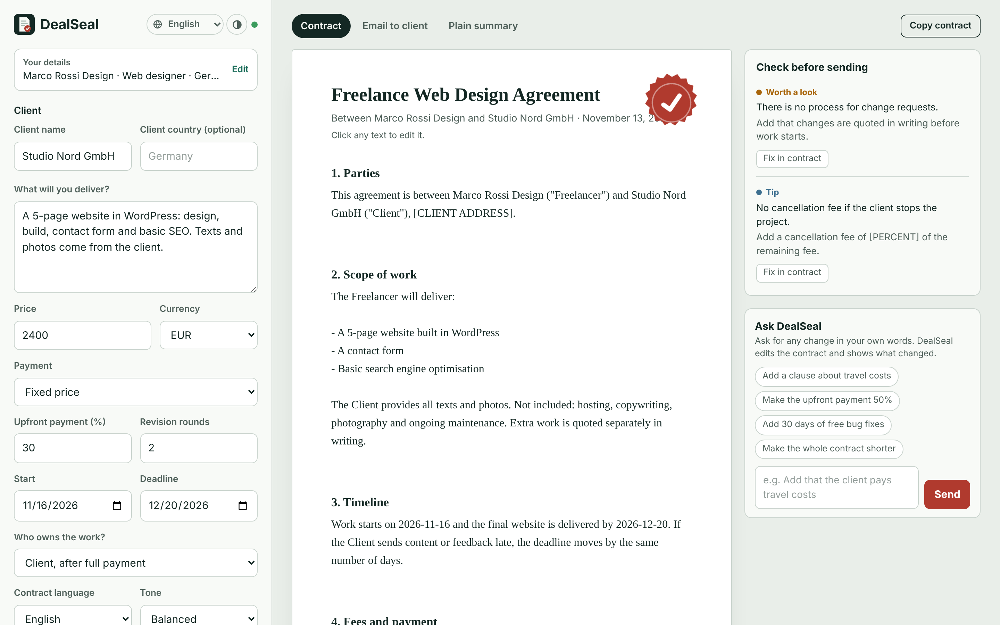

# DealSeal

An Anna App that drafts freelance contracts, a cover email to the client and a check of what could cost you money.



## What it does

Freelancers often start work on a handshake, then lose money on unpaid deposits, endless revisions and scope creep. DealSeal turns a short brief into a complete, plain-language contract in under a minute.

- **Complete contract in sections.** Parties, scope, timeline, payment, revisions, ownership, confidentiality, termination, liability and governing law, with signature lines for both sides.
- **No invented facts.** The model only uses names, amounts and dates from the brief. Anything missing becomes a visible placeholder like `[CLIENT ADDRESS]`.
- **Revise by chatting.** "Ask DealSeal" takes any change in plain words: add a clause, change the deposit, drop a section, shorten everything, rewrite the email. The request goes to an Anna agent session together with the deal facts and the current contract (including hand edits). The model answers with structured section changes; the app applies them, renumbers the sections, highlights what changed, lists changed amounts and dates, and keeps an undo for the latest change.
- **Edit in place.** Every heading and paragraph can be edited directly; edits are saved.
- **Safe rewrites.** "Simpler" and "Protect me more" rewrite one section. The result is checked in code: if it drops or changes an amount, percentage or date, it is retried once with a warning and otherwise refused.
- **Check before sending.** Local rules flag a missing price, no upfront payment, a deadline before the start date, a vague scope and too many revision rounds. The model adds up to four deal-specific risks, each with "Fix in contract", which rewrites the right section.
- **Cover email and plain summary** for the client, in the contract language.
- **Copy with formatting.** Headings, lists and signature lines paste cleanly into Word or Google Docs.
- **Your details** (name, role, country, payment terms) are saved once and used in every contract.
- **Five interface languages** (English, German, Chinese, Russian, Hindi) and **14 contract languages**.
- **History** of the last 10 contracts, light and dark mode.

DealSeal drafts contracts, it is not a lawyer. The app says so on every contract.

## How AI is used

Drafting runs two `anna.llm.complete` calls in parallel: one writes the contract as JSON sections, the other writes the email, the summary and the risk flags. Splitting them keeps each answer short enough not to be cut off and lets the contract show even if the extras fail. Section rewrites send the deal facts plus one section and an instruction, and the app verifies the numbers before accepting the result.

Chat edits use `anna.agent.session` (submode `auto`, a system prompt with the editing rules and the JSON answer format, no tools). The session keeps the conversation on the server; every run streams back, and every terminal state is handled: streamed text, `task_complete`, `task_cancelled` (the Stop button calls `session.cancel`), error frames, `empty_completion` (retried once) and expired sessions (replaced once). If no agent session is available for the user, the same request goes to `anna.llm.complete` with the recent turns included, so the chat keeps working. Your details, the last brief and the history are stored per user with `anna.storage`.

## Project layout

| Path | What |
|---|---|
| `app.json` | Store listing, logo and screenshots |
| `manifest.json` | Schema 4 manifest: static SPA bundle (host APIs need no declaration in schema 4) |
| `bundle/index.html` | UI |
| `bundle/style.css` | Styles, light and dark |
| `bundle/app.js` | App logic, prompts, checks, storage |
| `bundle/i18n.js` | Interface texts in five languages |
| `bundle/icon.svg`, `logo.svg` | Window icon and store logo (source) |
| `docs/` | Logo PNGs and store screenshots |
| `fixtures/happy-path.jsonl` | Canned answer for offline testing |

No backend and no Executa: everything runs in the Anna iframe.

## Run locally

```bash
npm install
npm run validate
npm run dev:mock          # local harness with a canned answer
anna-app login --host https://anna.partners
npm run dev               # local harness against the real Anna model
```

## Publish

```bash
npm run publish
```

Then install the draft from the Anna developer console, test it, and submit the version for review.

## License

MIT
